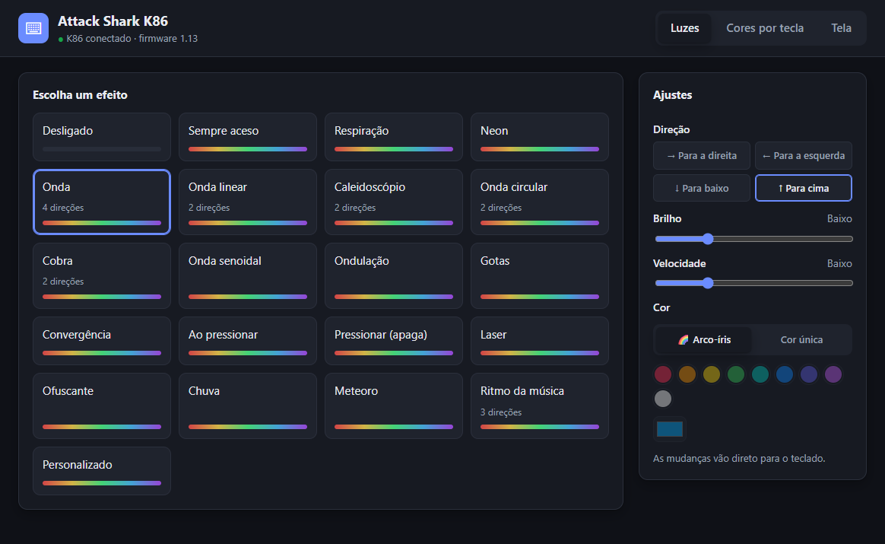
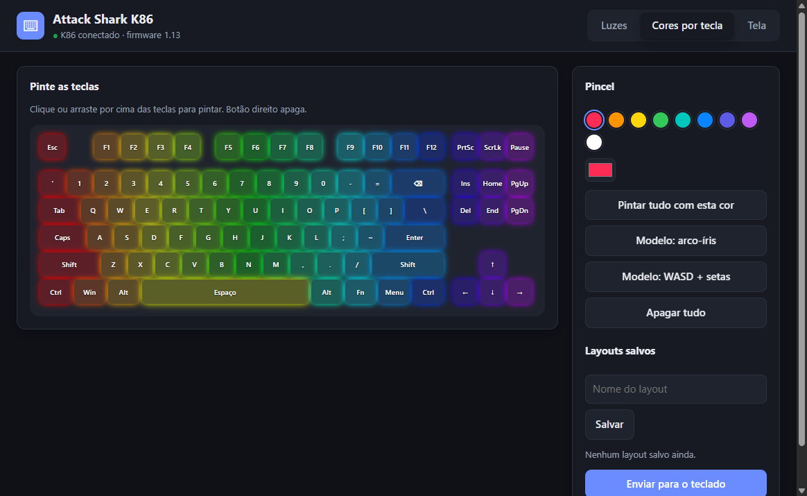
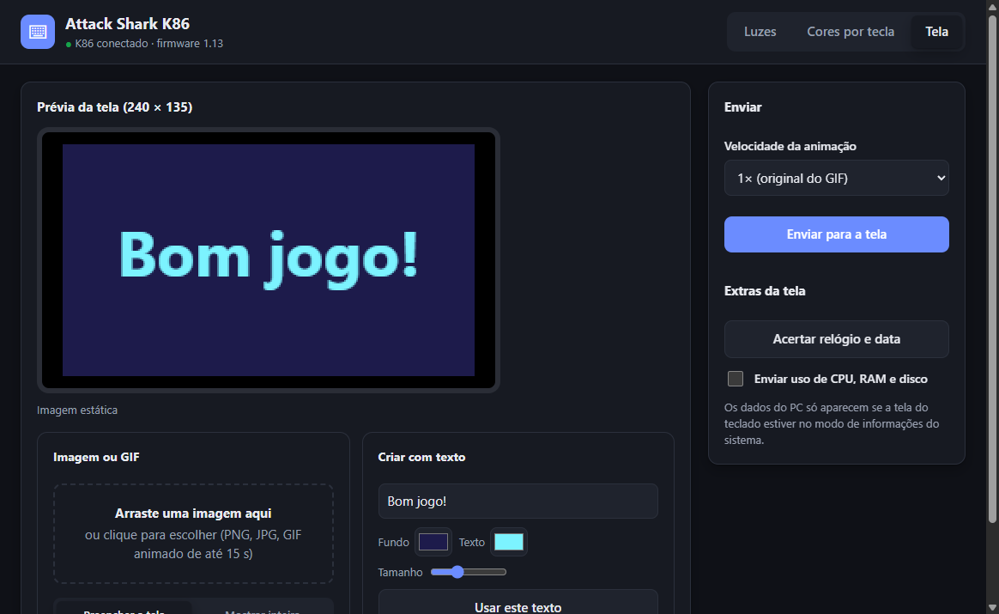

# Attack Shark K86 — app não oficial

App de Windows, em português, para personalizar o teclado mecânico **Attack Shark K86**:
efeitos de luz com direção, cores por tecla e a tela (imagem, GIF de até 15 s, texto, relógio e dados do PC).
Feito para ser mais simples e direto que o driver oficial.



> **App não oficial.** Não tem ligação com a Attack Shark. "Attack Shark" e "K86" são marcas dos seus donos.
> Use por sua conta e risco.

## Baixar e instalar

1. Baixe **`Instalar-Attack-Shark-K86-<versão>.exe`** na página de [Releases](../../releases/latest).
2. Dê dois cliques. Se aparecer "O Windows protegeu o computador", clique em
   **Mais informações → Executar assim mesmo** (o app não tem assinatura digital paga).
3. Abra **Attack Shark K86** pelo Menu Iniciar.

Instala só para o seu usuário, sem pedir administrador. Para desinstalar:
Configurações → Aplicativos → Aplicativos instalados → Attack Shark K86.

## Compatibilidade

| Teclado | Status |
|---|---|
| Attack Shark K86 com chip yc3121 — aparece no Windows como `VID_3151&PID_4015` | ✅ testado (firmware 1.13) |
| Attack Shark K86 com chip yc3123 — `VID_3151&PID_5002` | ❌ protocolo diferente, não reconhecido |

Conexão testada: **cabo USB**. 2,4 GHz e Bluetooth não foram testados.
Para ver o seu: Gerenciador de Dispositivos → Teclados → Propriedades → Detalhes → IDs de hardware.

## O que dá para fazer

**Luzes** — 21 efeitos, com **direção** onde o teclado permite (onda para a direita/esquerda/cima/baixo,
caleidoscópio do centro para fora ou para dentro, onda circular horária/anti-horária…), brilho, velocidade,
arco-íris ou cor única. Muda na hora.

**Cores por tecla** — pinte as teclas clicando e arrastando (botão direito apaga), use modelos prontos
e salve seus layouts com nome.



**Tela (240 × 135)** — imagem, GIF animado de até 15 s (na velocidade original, ou de 0,5× a 2×) ou texto;
acertar o relógio; enviar uso de CPU, RAM e disco.



Se o driver oficial ficou rodando escondido (o desinstalador oficial às vezes deixa o `iot_driver` aberto),
o app avisa e oferece o botão **Encerrar driver antigo**.

## Como funciona

O protocolo HID do K86 foi descoberto por engenharia reversa do driver oficial com o
[REA](https://github.com/morluto/rea), para fins de interoperabilidade:

- [docs/PROTOCOLO.md](docs/PROTOCOLO.md) — comandos, checksum, efeitos, envio para a tela
- [docs/ENGENHARIA-REVERSA.md](docs/ENGENHARIA-REVERSA.md) — como foi descoberto, passo a passo

O app nunca usa os comandos perigosos do firmware (reset de fábrica, apagar a memória da tela, atualização de firmware).

## Desenvolvimento

Requer **Node.js 24** e Windows.

```bash
npm install
```

```bash
npm start
```

| Comando | O que faz |
|---|---|
| `npm start` | Abre o app (Electron) sem instalar |
| `npm run servidor` | Só o servidor local, para abrir no navegador em `http://127.0.0.1:5186` |
| `npm run instalador` | Gera `dist/Instalar Attack Shark K86.exe` |
| `npm run capturas` | Gera de novo as imagens de `docs/img` (com o teclado conectado) |
| `node ferramentas/teste-versao.mjs` | Lê a versão do firmware (somente leitura) |
| `node ferramentas/teste-codificacao-tela.mjs` | Confere a codificação de imagem da tela |
| `node ferramentas/teste-planejar-animacao.mjs` | Confere a divisão de quadros dos GIFs |

Se o npm não baixar o Electron sozinho: `node node_modules/electron/install.js`.

| Arquivo | Para quê |
|---|---|
| `main.mjs` | App Electron: abre a janela e inicia o servidor interno |
| `servidor.mjs` | Servidor local (só `127.0.0.1`) que liga a interface ao teclado |
| `k86.mjs` | Protocolo HID do K86 |
| `public/` | Interface (HTML, CSS, JS) |
| `ferramentas/` | Testes e gerador do ícone |

## Licença

[MIT](LICENSE)
